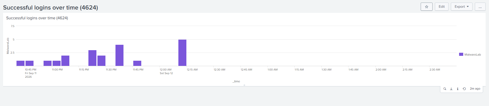
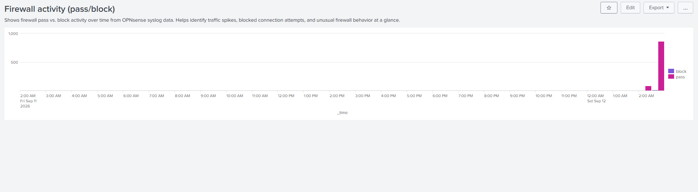
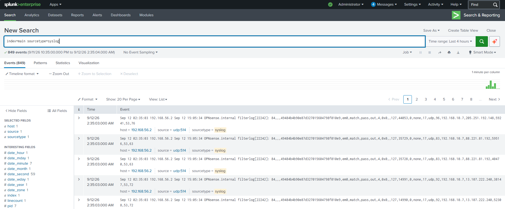
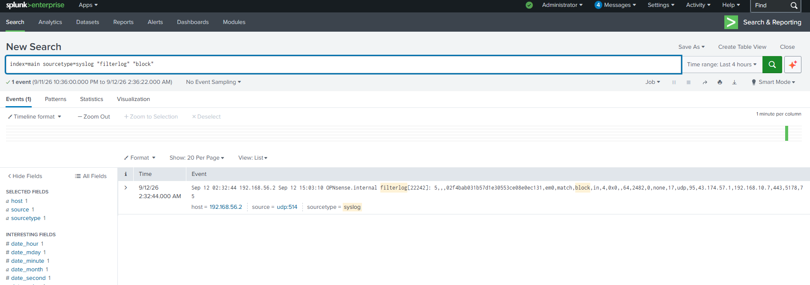
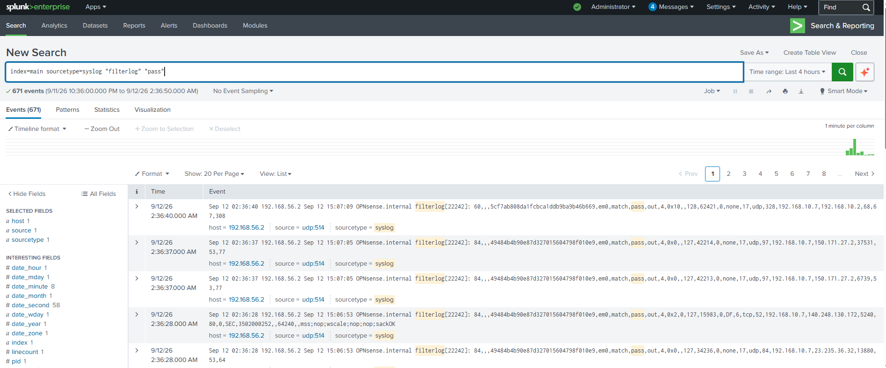
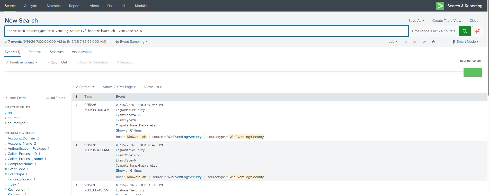
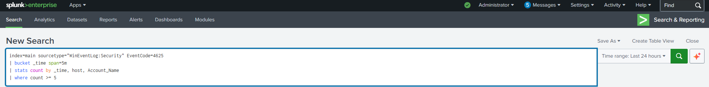
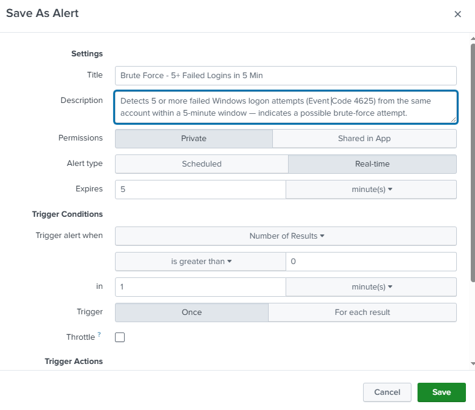
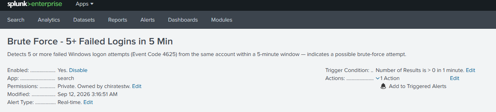
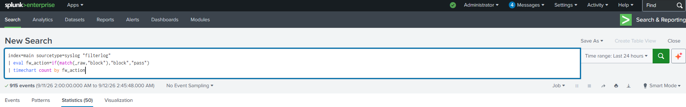

# Home SOC Lab – OPNsense, Active Directory & Splunk

A virtualized Security Operations Center (SOC) lab built using VirtualBox, OPNsense, Windows Server 2022, Windows 10, and Splunk Enterprise.

This project demonstrates centralized log collection, firewall monitoring, SIEM dashboard development, and security detection engineering through controlled lab activities.

## Project Overview

The lab simulates a small enterprise network where endpoint and firewall telemetry are collected centrally in Splunk Enterprise for monitoring and investigation.

### Objectives

- Centralize Windows event logs from a domain controller and Windows workstation
- Forward OPNsense firewall and system logs to Splunk
- Build dashboards to monitor authentication and firewall activity
- Develop and test detection use cases for suspicious account activity
- Map detection use cases to MITRE ATT&CK techniques

## Lab Architecture

The environment consists of three virtual machines:

| System | Role | Configuration |
|---|---|---|
| OPNsense | Firewall, router and DHCP | WAN: NAT / LAN: Host-only |
| DC01 | Windows Server 2022, Active Directory, DNS and Splunk Enterprise | 192.168.56.10 |
| MalwareLab | Windows 10 endpoint and Splunk Universal Forwarder | 192.168.56.20 |

**Network configuration**

- Lab LAN: `192.168.56.0/24`
- OPNsense LAN: `192.168.56.2`
- OPNsense WAN: DHCP on NAT network
- Domain: `mylab.local`

## Technologies Used

- Oracle VirtualBox
- OPNsense 26.7
- Windows Server 2022
- Windows 10
- Active Directory Domain Services
- Splunk Enterprise
- Splunk Universal Forwarder
- Syslog
- Splunk Search Processing Language (SPL)

## Log Collection and SIEM Integration

| Log Source | Collection Method | Destination |
|---|---|---|
| MalwareLab Windows events | Splunk Universal Forwarder | Splunk TCP 9997 |
| DC01 Windows events | Local event log input | Splunk Enterprise |
| OPNsense firewall and system logs | Remote Syslog over UDP 514 | Splunk Enterprise |

Windows Application, Security, and System events were collected. OPNsense forwarded firewall and system messages to Splunk for centralized monitoring.

## Splunk Dashboard

A multi-panel dashboard was developed to provide visibility into:

- Successful logon events (Event ID 4624)
- Failed logon events (Event ID 4625)
- Accounts generating failed logons
- Firewall pass and block activity
- Failed logon event details

## Detection Use Cases

### 1. Repeated Failed Logon Attempts

- Windows Event ID: `4625`
- MITRE ATT&CK: `T1110 – Brute Force`
- Detection logic: Five or more failed logon events within a five-minute window.
- Test result: A controlled local password-guessing test generated seven Event ID 4625 events.
- Validation: The SPL search identified the threshold condition. End-to-end scheduled alert validation remains pending because the saved alert configuration requires correction and retesting.

### 2. New Local User Account Creation

- Windows Event ID: `4720`
- MITRE ATT&CK: `T1136 – Create Account`
- Detection logic: Monitor Windows Security logs for new user account creation.
- Test result: A local test account was created on MalwareLab.
- Validation: Splunk identified the Event ID 4720 event, and the alert appeared in Triggered Alerts approximately two minutes after the test.

## Troubleshooting and Lessons Learned

During implementation, I worked through issues involving:

- OPNsense WAN and LAN interface assignments
- Virtual machine network connectivity
- Splunk Universal Forwarder configuration
- Remote Syslog ingestion
- Windows event log sourcetype filtering
- Splunk search time ranges and field extraction
- Scheduled alert configuration and validation

## Limitations

- The brute-force simulation used local Windows lock-screen attempts rather than remote RDP or SMB password guessing.
- The scheduled brute-force alert requires further validation.
- Email notifications, ticketing, and SOAR integrations are not configured.
- Splunk runs on a single host without SIEM redundancy.

## Future Improvements

- Deploy Sysmon on Windows endpoints for additional process and network telemetry.
- Add detections for account lockouts, security-group modifications, account deletion, and audit-log clearing.
- Perform controlled network port-scanning tests.
- Configure email notifications for scheduled alerts.
- Expand detection coverage and improve alert validation.

## Skills Demonstrated

- SIEM deployment and administration
- Windows event log analysis
- Network security monitoring
- Firewall configuration and log analysis
- Log forwarding and Syslog integration
- SPL query development
- Security detection engineering
- MITRE ATT&CK mapping
- Incident investigation and troubleshooting

## Project Documentation

The detailed project report and supporting screenshots are available in this repository.

## Screenshots

### Splunk Dashboards

**Successful Logins Dashboard**



**Firewall Activity Dashboard**



### OPNsense Firewall Monitoring

**Syslog Events**



**Blocked Traffic**



**Passed Traffic**



### Security Detection Use Cases

**Failed Logon Events – Event ID 4625**



**Brute-Force Detection SPL Query**



**Brute-Force Alert Configuration**



**Saved Brute-Force Alert**



### Firewall Analysis

**Firewall Pass/Block SPL Query**


---

## Splunk SPL Queries

The following SPL queries were used in this lab for Windows Security event monitoring, OPNsense firewall log analysis, dashboard visualizations, and security detection use cases.

### 1. Windows Security Event Monitoring

**Successful Logons – Event ID 4624**

```spl
index=main sourcetype="WinEventLog:Security" EventCode=4624
| timechart count by host
```

**Failed Logons – Event ID 4625**

```spl
index=main sourcetype="WinEventLog:Security" EventCode=4625
| timechart count by host
```

**Top Accounts by Failed Logons**

```spl
index=main sourcetype="WinEventLog:Security" EventCode=4625
| stats count by Account_Name
| sort -count
```

**Failed Logon Event Details**

```spl
index=main sourcetype="WinEventLog:Security" EventCode=4625
| table _time host Account_Name Failure_Reason
| sort -_time
```

### 2. OPNsense Firewall Monitoring

**Syslog Event Collection**

```spl
index=main sourcetype=syslog
```

**Firewall Pass and Block Activity**

```spl
index=main sourcetype=syslog "filterlog"
| eval fw_action=if(match(_raw,"block"),"block","pass")
| timechart count by fw_action
```

**Blocked Firewall Traffic**

```spl
index=main sourcetype=syslog "filterlog" "block"
```

**Passed Firewall Traffic**

```spl
index=main sourcetype=syslog "filterlog" "pass"
```

### 3. Security Detection Use Cases

**Brute-Force Detection – Event ID 4625**

Identifies five or more failed logon attempts associated with the same account within a five-minute time window.

```spl
index=main sourcetype="WinEventLog:Security" EventCode=4625
| bucket _time span=5m
| stats count by _time, host, Account_Name
| where count >= 5
```

**New User Account Creation – Event ID 4720**

Identifies local user account creation and extracts the account that performed the action and the newly created account.

```spl
index=main sourcetype="WinEventLog:Security" EventCode=4720
| eval created_by=mvindex(Account_Name,0),
       new_account=mvindex(Account_Name,1)
| table _time host created_by new_account
```

### Detection Validation Notes

- **New User Account Creation:** Validated using Event ID 4720. The search returned the account creation event, and the alert appeared in Triggered Alerts approximately two minutes after testing.
- **Brute-Force Detection:** The controlled test generated seven Event ID 4625 records. The intended SPL query identified the five-or-more failures threshold within a five-minute window. The saved scheduled alert still requires correction and end-to-end retesting.

**Disclaimer:** This project was developed in an isolated VirtualBox lab environment using test accounts and controlled security activities. No production systems or real user accounts were involved.
